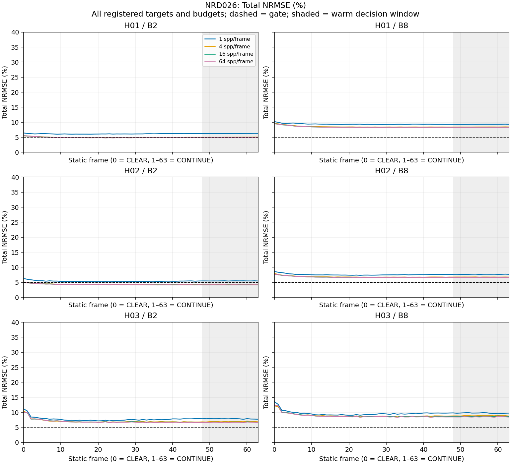
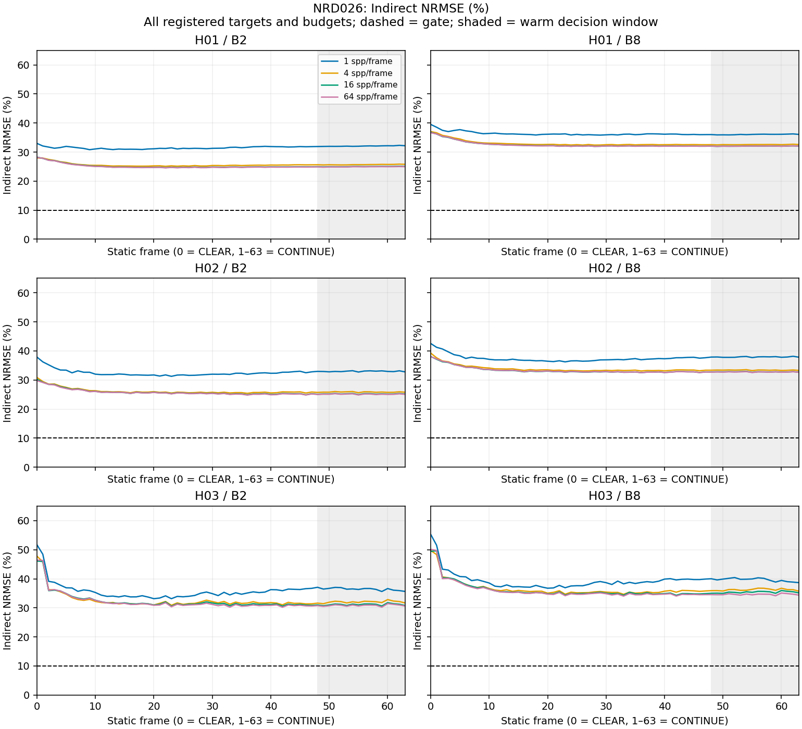
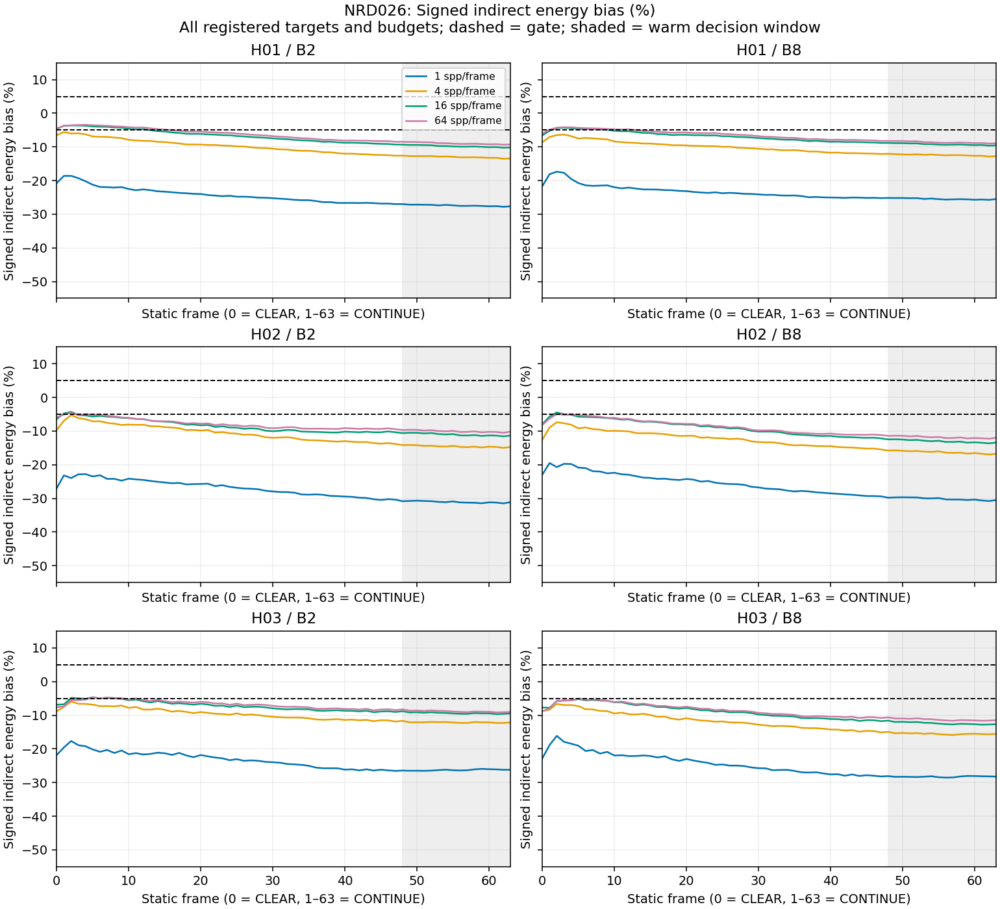

# NRD026: complete six-target cold/warm HDR outcome

**SIX_TARGETS_COMPLETE_0_JOINT_PASS_6_EXHAUSTED_NO_ACCEPTED_TIMING.** All six targets are terminal: 0 joint passes, 6 exhausted quality losses. The bounded026 cohort is complete; Lane M remains incomplete. No accepted timing, GPU-memory superiority or architecture promotion.

[Registration026](../experiments/026-nrd-cold-and-64-frame-static-hdr-quality.md), [CPU readiness146](146-nrd-cold-warm-hdr-cpu-preparation.json), [final H03/B8 result162](162-nrd-cold-warm-h03-b8-hdr-outcome.json), [complete summary163](163-nrd-cold-warm-six-targets-summary.json), [preservation verification165](165-nrd-cold-warm-six-targets-verification.json). Earlier target outcomes147/150/153/156/159 and checkpoints remain immutable.

Registration5753113e, pre-execution history clarification88bb0b19, implementationacb968a1 and CPU readiness4712178d precede execution. Final-target plans use362114724c5b9892fcf0a3723aefecc29849a315. There were 4 new final-target processes/256 frames, bringing026 to 24 separately announced acquisitions/1536 frames in the fixed H01/B2,H01/B8,H02/B2,H02/B8,H03/B2,H03/B8 order. The per-target ladder is [1,4,16,64], stopping at first joint PASS or exhausted64. No retry, extra rung, tuning or omitted failure. Operational/physical/input/history/SDK/lifetime audits pass for every acquisition; image quality is a separate decision. 0 of 1536 individual frames pass all image gates.

Each process has frame0CLEAR and63CONTINUE frames with the preregistered distinct seeds. Exact admitted16384spp/four-seed references, inclusive all-pixel linear BT.709 luminance, total NRMSE<=5%, indirect NRMSE<=10% and absolute signed indirect energy bias<=5% are unchanged. Direct correctness separately passes NRMSE<=1e-4, maximum absolute error<=1e-5 and zero GPU-zero/reference-positive pixels. Cold means frame0; warm requires EACH frame48..63; joint requires both. The frame63 values below are diagnostics and do not replace that16-frame decision. No temporal mean is used for admission.

| Target | spp/frame | Cold total NRMSE | Frame63 total NRMSE | Cold indirect NRMSE | Frame63 indirect NRMSE | Frame63 signed indirect bias | Cold / warm / joint |
| --- | ---: | ---: | ---: | ---: | ---: | ---: | :---: |
| H01/B2 | 1 | 6.4367% | 6.2775% | 32.9931% | 32.1770% | -27.6437% | FAIL / FAIL / FAIL |
| H01/B2 | 4 | 5.4584% | 5.0313% | 27.9786% | 25.7895% | -13.4444% | FAIL / FAIL / FAIL |
| H01/B2 | 16 | 5.5151% | 4.8898% | 28.2691% | 25.0642% | -10.1597% | FAIL / FAIL / FAIL |
| H01/B2 | 64 | 5.4970% | 4.8731% | 28.1767% | 24.9786% | -9.2795% | FAIL / FAIL / FAIL |
| H01/B8 | 1 | 10.2080% | 9.3200% | 39.5173% | 36.0798% | -25.4824% | FAIL / FAIL / FAIL |
| H01/B8 | 4 | 9.5708% | 8.4216% | 37.0506% | 32.6017% | -12.7384% | FAIL / FAIL / FAIL |
| H01/B8 | 16 | 9.5120% | 8.2841% | 36.8231% | 32.0693% | -9.5239% | FAIL / FAIL / FAIL |
| H01/B8 | 64 | 9.4669% | 8.2792% | 36.6481% | 32.0503% | -8.8871% | FAIL / FAIL / FAIL |
| H02/B2 | 1 | 6.2768% | 5.4314% | 37.8751% | 32.7737% | -31.1225% | FAIL / FAIL / FAIL |
| H02/B2 | 4 | 5.1155% | 4.2724% | 30.8678% | 25.7800% | -14.7131% | FAIL / FAIL / FAIL |
| H02/B2 | 16 | 5.0062% | 4.1698% | 30.2081% | 25.1610% | -11.3122% | FAIL / FAIL / FAIL |
| H02/B2 | 64 | 4.9354% | 4.1499% | 29.7810% | 25.0410% | -10.1689% | FAIL / FAIL / FAIL |
| H02/B8 | 1 | 8.6082% | 7.6522% | 42.5627% | 37.8360% | -30.4977% | FAIL / FAIL / FAIL |
| H02/B8 | 4 | 7.9382% | 6.7346% | 39.2501% | 33.2988% | -16.7688% | FAIL / FAIL / FAIL |
| H02/B8 | 16 | 7.7035% | 6.6143% | 38.0892% | 32.7038% | -13.4270% | FAIL / FAIL / FAIL |
| H02/B8 | 64 | 7.6917% | 6.6024% | 38.0309% | 32.6449% | -11.9637% | FAIL / FAIL / FAIL |
| H03/B2 | 1 | 11.1495% | 7.6883% | 51.6971% | 35.6483% | -26.2190% | FAIL / FAIL / FAIL |
| H03/B2 | 4 | 10.3081% | 6.8335% | 47.7957% | 31.6850% | -12.1531% | FAIL / FAIL / FAIL |
| H03/B2 | 16 | 9.9505% | 6.6418% | 46.1379% | 30.7963% | -9.4743% | FAIL / FAIL / FAIL |
| H03/B2 | 64 | 10.0161% | 6.6029% | 46.4421% | 30.6158% | -9.0190% | FAIL / FAIL / FAIL |
| H03/B8 | 1 | 13.5466% | 9.4767% | 55.2860% | 38.6760% | -28.2402% | FAIL / FAIL / FAIL |
| H03/B8 | 4 | 12.1804% | 8.7576% | 49.7103% | 35.7413% | -15.5438% | FAIL / FAIL / FAIL |
| H03/B8 | 16 | 12.1175% | 8.6101% | 49.4535% | 35.1391% | -12.6573% | FAIL / FAIL / FAIL |
| H03/B8 | 64 | 12.2871% | 8.4248% | 50.1454% | 34.3831% | -11.4592% | FAIL / FAIL / FAIL |

All64 scores, warm minima/maxima/failed-frame indices, full error arrays and temporal mean/variance/consecutive RMS diagnostics remain available in the raw audits pinned by163. The following figures show all targets, budgets and frames without clipping or exclusions; dashed lines mark the original gates and shading marks frames48..63. These are saved-score plots, not new image/reference sampling or metric reruns.

Scientific plot source CSV, PNG/PDF/SVG exports, exact artifact/source identities and a receipt are in repository out/research/lane-m-gi-competitiveness/m001-nrd026-six-targets-summary-v1 and m001-nrd026-six-targets-plots-v1. Plotting uses a separate out/ environment pinned to [Matplotlib3.10.7](https://pypi.org/project/matplotlib/3.10.7/); the qualified experiment Python environment is unchanged. Small derived PNGs are tracked; large captures/full errors remain in out/.

The first plot-environment preparation v1 stopped before creating an environment because the uv shim had no installed version (returncode1). Its receipt/logs remain exact in out/.../m001-nrd026-plot-environment-preparation-v1. Version2 uses standard Python venv/pip in a new exclusive plot-env-v2 and retains the prior failure identity; this tool-only repair changes no experiment code, image metric or GPU acquisition. Both preparation identities are checked by165.

All64 frames pass complete primary presence/primitive/depth/canonical/unit-normal, sample miss/unit/in-lobe/ordered float32 sum/mean, official guide/UNORM/viewZ/static-motion/input-error and RGB composition checks. All 88,473,600 primary records and 236,563,840 active secondary sample witnesses are checked. Winding-normal differences remain reported, with no winding-normal equality claim. ALL active secondary rays in frames0,1,63 receive independent double-precision triangle intersections under unchanged024 distance bounds: 11,088,930 rays, zero presence/primitive failures. Other61 frames retain/check every witness, guide and primary record; independent secondary intersections are not claimed for them. This is a static history experiment, not a ghosting/dynamic validation.

Frame0 raw PT exactly matches original same-depth/budget/seed captures. Supplemental CPU uint32 comparisons prove all 24 cold cases/16,588,800 bytes, including the signed-zero distinction that the frozen auditor's numeric np.array_equal does not itself prove. Four new final-target cases are directly compared, reusing the previous20-case proof only after all receipt/input hashes match. Native auditor/source and criteria remain unchanged; no old GPU/image/reference or metric cohort is rerun. Exact bitword receipts are bound in162/163. Only H01/B2/16,H02/B8/64,H03/B2/64 have the additional47-field byte-exact025 cold controls; H03/B8 has no such025 full-field control.

Stored history advances1..31 then clamps, including the current frame under default maxAccumulatedFrameNum30. Each actual SDK stream exactly matches025 CPU exports:651 dispatches/481,632 constant bytes and all15 selected pipelines. Only pipeline9 differs from unmodified023; the other14 are exact. Cohort totals: 15,624 SDK dispatches, 11,559,168 constant bytes and 732,960 ordered bounded units. All full journals, envelopes/startup/readbacks/pauses/history costs remain recorded. Per-process37 allocation/free pairs and15 images reconcile to zero teardown; full owned peaks are in163, excluding driver-private and CPU memory. Timestamps remain uncalibrated diagnostics; no quality-matched speed or GPU-memory superiority follows.

Qualified CPU52 Python contracts,24 valid/eight rejected native inputs and six admitted reference identities are reused without rerun. The two-step026 host-only compile/relink is unchanged;025 SDK/shaders and other objects are reused. Assistant-operated Radeon8060S/RADV runs were explicitly authorized, without power/clock/desktop changes or competing workload. GPU guards remain120CPU/180wall/4GiB address space,8GiB aggregate-owned cap,250ms waits,2ms pauses and32GiB free disk; one announced command and independent terminal audit precede each next rung. Verification165 rehashes evidence and replays the saved decision predicates; it does not reacquire images or rerun the original full quality metrics. Default Renderer build/runtime regression NOT_RERUN, validation layers NOT_RUN. Default build graph, N001–N010 evidence and every prior success/failure remain unchanged. No Actions/CI/main promotion. Total independently audited assistant acquisitions including the024 operational failure: 160.

The measured conclusion concerns this disclosed sky-initialized default RELAX_DIFFUSE role on six known static synthetic targets. It does not reject the NRD family, prove fair optimal tuning, or establish real-time performance.026 ends with no further026 process selected; its original plan, all losses and fixed thresholds remain intact. In particular, no failed NRD target enters a same-quality timing ranking.

Next, audit the external-baseline input/semantic boundary and design a separately preregistered calibrated complete-cost comparison for quality-admitted PT and integrated022. Any NRD setting change or new image experiment needs a new registration; do not retune026 or relabel an established reconstruction component as novel transport. The full charter still requires a novel competitive image-producing Renderer, representative GI alternatives, independent new heldouts, camera/light/rigid/deforming/topology/churn regimes, Sponza and other scenes, multiple GPU classes, deployability, true-peak memory and actual-boundary timing calibration. The incumbent remains SRC; Lane M and Issue7 remain open.
