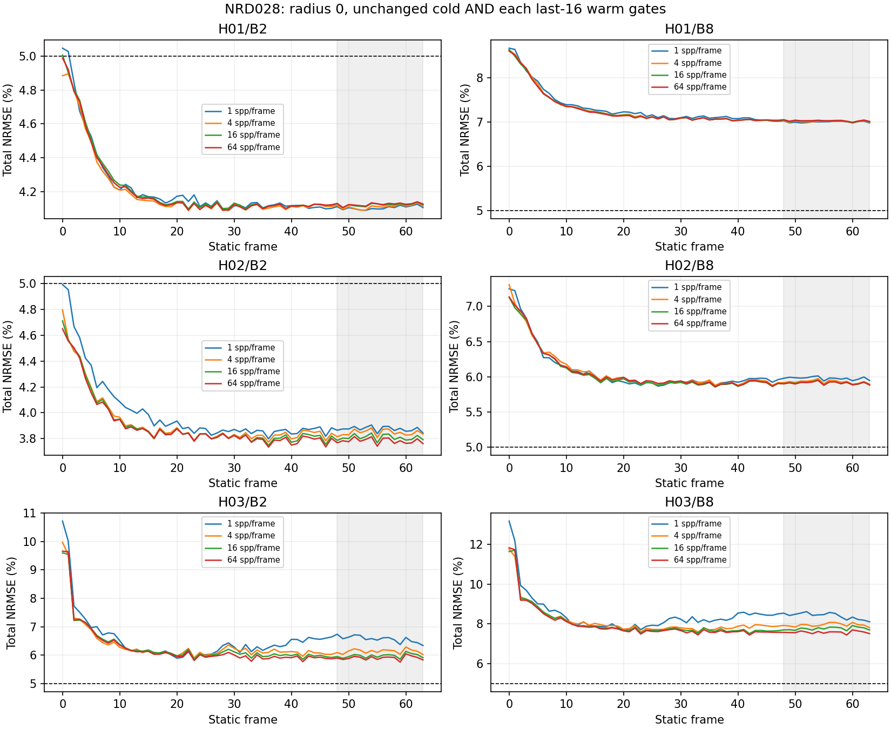
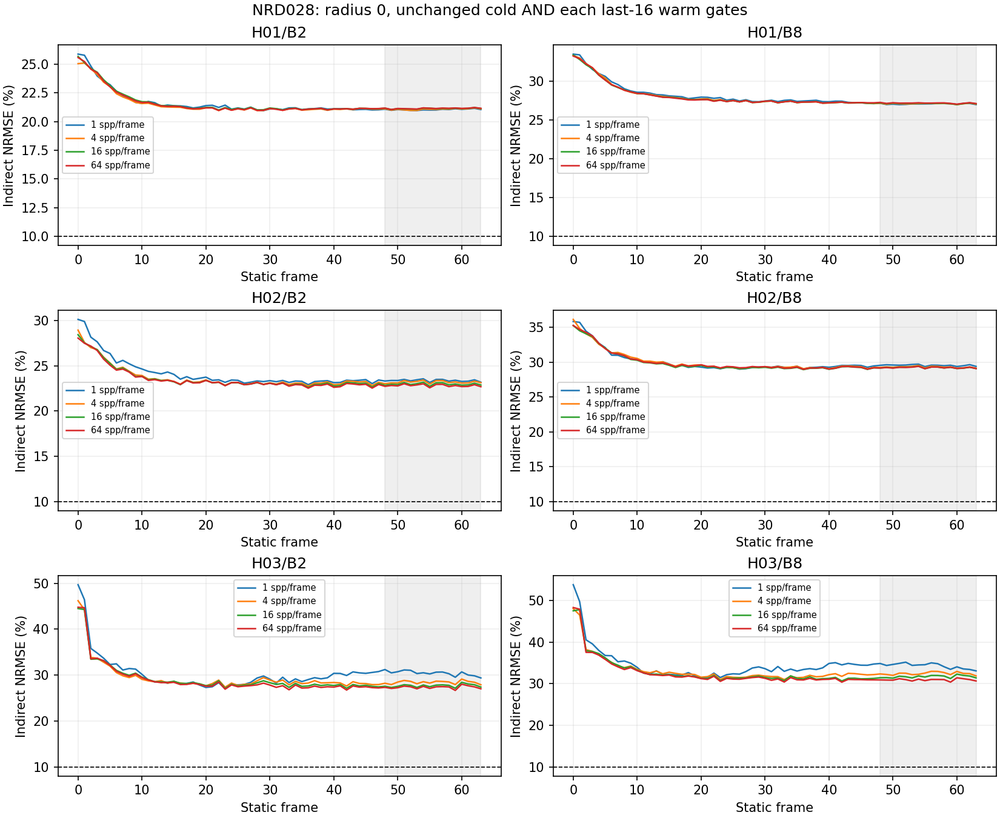
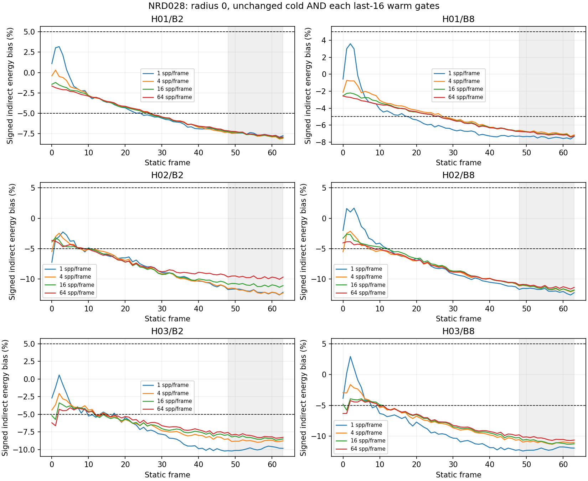

# NRD028: complete six-target no-prepass cold/warm HDR outcome

**SIX_TARGETS_COMPLETE_0_JOINT_PASS_6_EXHAUSTED_NO_ACCEPTED_TIMING.** All six targets are terminal: 0 joint passes, 6 exhausted quality losses. The finite028 study is complete; Lane M remains incomplete. No accepted timing, GPU-memory superiority or architecture promotion.

[Registration028](../experiments/028-nrd-diffuse-no-prepass-cold-warm-quality.md), [CPU preparation170](170-nrd-no-prepass-cpu-preparation.json), [CPU verification171](171-nrd-no-prepass-cpu-verification.json), [final H03/B8 outcome187](187-nrd-no-prepass-h03-b8-hdr-outcome.json), [complete summary188](188-nrd-no-prepass-six-targets-summary.json), [preservation verification190](190-nrd-no-prepass-six-targets-verification.json). Earlier target outcomes172/175/178/181/184 and their checkpoints remain immutable.

Only diffusePrepassBlurRadius30→0 changes from026. The source-pinned025 sky-initialized SDK library/all15 selected SPIR-V,024 physical producer/packing/composition, all other defaults, camera/geometry/depth/RNG/sample order, guides and references remain fixed. The sparse-bright-sample motivation is an upstream Reblur comment applied here as our RELAX hypothesis, not an upstream optimal RELAX recommendation. PrePass still executes and the SDK schedules10 RELAX dispatches per frame. This is a finite configured established-family comparison on known static development scenes, not blind heldouts, optimal tuning, a family-wide rejection or novel transport.

Registration892708b3, implementationa9efec9d, committed provenance/overlay repairs and CPU readiness8616ab8e precede GPU execution. Final-target plans useb92a0246aee1dcbb8ed9615e46af2671c0017600. 24 separately announced acquisitions/1536 frames follow H01/B2,H01/B8,H02/B2,H02/B8,H03/B2,H03/B8 with the fixed [1,4,16,64] ladder, first joint PASS or exhausted64. No repeat, omitted loss, extra rung, setting rescue or automatic queue. Operational/physical/input/history/SDK/owned-lifetime checks pass; quality is a separate decision. 0 individual frames satisfy every original image gate.

Original admitted16384spp/four-seed physical references and inclusive all-pixel linear BT.709 luma remain fixed: total NRMSE<=5%, indirect NRMSE<=10%, absolute signed indirect energy bias<=5%; direct NRMSE<=1e-4,maximum absolute<=1e-5,zero lost-positive support. Frame0 is Cold; Warm requires EACH frame48..63; Joint requires both. Frame63 values below are diagnostics, not a substitute for all16 warm decisions. No temporal mean is used for admission.

| Target | spp/frame | Cold total NRMSE | Frame63 total NRMSE | Cold indirect NRMSE | Frame63 indirect NRMSE | Frame63 signed indirect bias | Cold / warm / joint |
| --- | ---: | ---: | ---: | ---: | ---: | ---: | :---: |
| H01/B2 | 1 | 5.0472% | 4.1059% | 25.8711% | 21.0460% | -7.7448% | FAIL / FAIL / FAIL |
| H01/B2 | 4 | 4.8847% | 4.1162% | 25.0381% | 21.0990% | -8.0800% | FAIL / FAIL / FAIL |
| H01/B2 | 16 | 5.0068% | 4.1225% | 25.6637% | 21.1310% | -7.9849% | FAIL / FAIL / FAIL |
| H01/B2 | 64 | 4.9891% | 4.1266% | 25.5731% | 21.1522% | -7.9072% | FAIL / FAIL / FAIL |
| H01/B8 | 1 | 8.6617% | 6.9790% | 33.5312% | 27.0173% | -7.3270% | FAIL / FAIL / FAIL |
| H01/B8 | 4 | 8.6183% | 6.9932% | 33.3634% | 27.0721% | -7.1373% | FAIL / FAIL / FAIL |
| H01/B8 | 16 | 8.6325% | 7.0043% | 33.4182% | 27.1152% | -7.2605% | FAIL / FAIL / FAIL |
| H01/B8 | 64 | 8.5979% | 7.0118% | 33.2841% | 27.1442% | -7.2694% | FAIL / FAIL / FAIL |
| H02/B2 | 1 | 4.9922% | 3.8430% | 30.1235% | 23.1890% | -12.1537% | FAIL / FAIL / FAIL |
| H02/B2 | 4 | 4.7965% | 3.8350% | 28.9424% | 23.1407% | -12.2720% | FAIL / FAIL / FAIL |
| H02/B2 | 16 | 4.7124% | 3.7917% | 28.4351% | 22.8797% | -11.0618% | FAIL / FAIL / FAIL |
| H02/B2 | 64 | 4.6506% | 3.7607% | 28.0621% | 22.6926% | -9.6654% | FAIL / FAIL / FAIL |
| H02/B8 | 1 | 7.2495% | 5.9468% | 35.8446% | 29.4037% | -12.2276% | FAIL / FAIL / FAIL |
| H02/B8 | 4 | 7.3100% | 5.8950% | 36.1437% | 29.1472% | -11.8554% | FAIL / FAIL / FAIL |
| H02/B8 | 16 | 7.1317% | 5.8839% | 35.2623% | 29.0926% | -11.7864% | FAIL / FAIL / FAIL |
| H02/B8 | 64 | 7.1344% | 5.8835% | 35.2758% | 29.0905% | -11.3664% | FAIL / FAIL / FAIL |
| H03/B2 | 1 | 10.7195% | 6.3391% | 49.7036% | 29.3928% | -9.8136% | FAIL / FAIL / FAIL |
| H03/B2 | 4 | 9.9682% | 6.0208% | 46.2196% | 27.9167% | -8.7535% | FAIL / FAIL / FAIL |
| H03/B2 | 16 | 9.6006% | 5.9096% | 44.5155% | 27.4010% | -8.4884% | FAIL / FAIL / FAIL |
| H03/B2 | 64 | 9.6598% | 5.8304% | 44.7900% | 27.0339% | -8.2604% | FAIL / FAIL / FAIL |
| H03/B8 | 1 | 13.1825% | 8.1073% | 53.7998% | 33.0873% | -11.9403% | FAIL / FAIL / FAIL |
| H03/B8 | 4 | 11.7724% | 7.8134% | 48.0451% | 31.8879% | -11.0246% | FAIL / FAIL / FAIL |
| H03/B8 | 16 | 11.6451% | 7.6952% | 47.5255% | 31.4054% | -11.2443% | FAIL / FAIL / FAIL |
| H03/B8 | 64 | 11.8365% | 7.5140% | 48.3068% | 30.6660% | -10.6288% | FAIL / FAIL / FAIL |

All64 scores, full errors and temporal mean/variance/consecutive-RMS diagnostics remain in the raw audits pinned by188. All-frame figures use saved scores without sampling new images/references or recomputing old metrics. Dashed lines are original gates; shading marks frames48..63.

CSV and standalone PNG/PDF/SVG artifacts/identities are retained in repository out/research/lane-m-gi-competitiveness/m001-nrd028-six-targets-summary-v1 and m001-nrd028-six-targets-plots-v1. The existing separate Matplotlib3.10.7 plot environment is reused unchanged; the qualified experiment environment is unchanged. Only three small derived PNGs enter Git.

At64spp/frame, frame63 the saved026-versus028 comparison below is descriptive on already known development scenes, without significance, optimality or admission claims. All six targets are retained; this frame63 diagnostic decreases on all six, while their original Cold/Warm quality gates still fail. A smaller error that still fails the original Cold/Warm gates does not admit a target or establish competitive performance.

| Target | Default026 indirect NRMSE | Radius0/028 indirect NRMSE | Difference (percentage points) |
| --- | ---: | ---: | ---: |
| H01/B2 | 24.9786% | 21.1522% | -3.8264 |
| H01/B8 | 32.0503% | 27.1442% | -4.9061 |
| H02/B2 | 25.0410% | 22.6926% | -2.3484 |
| H02/B8 | 32.6449% | 29.0905% | -3.5544 |
| H03/B2 | 30.6158% | 27.0339% | -3.5819 |
| H03/B8 | 34.3831% | 30.6660% | -3.7172 |

All actual new producer/input-guide fields match corresponding anchored026 witnesses: 21504 fields/48218431488 bytes. All original receipts and full primary/secondary error payloads are rehashed before reusing026 all64 primary/sample/guide predicates and independent intersections of ALL active first-secondary rays at frames0,1,63: 11088930 reused rays. New secondary triangle intersections=0; other61 frames do not acquire an all-ray independent-intersection claim. Actual new data is preserved, not substituted with archived files. New denoised pools/RGB composition and all-pixel fsum/error maps are independently audited for028. No original026 quality or geometric cohort is rerun and no references are regenerated.

The supplemental24-case026 cold PT uint32 proof, including signed zero, is reused only after actual new raw PT/input bytes match.026 original47-field cold controls and025 reset evidence remain historical controls;028 does not claim new reset images or dynamic/ghosting validation. All15 pipelines stay identical; only the already disclosed025 pipeline9 sky initialization differs from unmodified023. Actual new SDK constants/commands agree with028 CPU exports. Histories advance1..31 then clamp, with one clear at frame0. Each process has651 SDK dispatches/481632 constant bytes,30540 bounded units,37 allocation/free pairs/15 images and zero teardown. Cohort totals: 15624 SDK dispatches/11559168 constant bytes/732960 units. Maximum true owned peak is 87196016 bytes, excluding driver-private/CPU memory. All setup, readback, pause, synchronization and history costs remain recorded; timestamps are uncalibrated diagnostics.

CPU readiness retains90 contract checks (56 reused),32 actual native CPU cases without repeats and195 new API frames. The two preparation failures and committed repairs remain exact: historical023 source-preflight and duplicate-overlay rejection. Successful compilation/native cases are reused only after hashes and overlay equality; no successful build or CPU experiment is retried. Actual GPU acquisitions are assistant-operated on Radeon8060S/RADV under explicit user authorization, without power/clock/desktop changes or competing workload. Guards remain120CPU/180wall/4GiB process/8GiB aggregate-owned,250ms waits,2ms unit pauses,32GiB disk,one announced command then independent terminal audit. Verification190 rehashes all028 cases and consumed inputs, replays saved decision predicates and verifies Git ancestry/preservation/index/links; it does not reacquire images or rerun full image metrics. Default Renderer build/runtime regression NOT_RERUN; Vulkan validation layers NOT_RUN. Default build graph/N001–N010 evidence and earlier results remain unchanged. No CI/Actions/main promotion. Total independently audited assistant acquisitions including024 failure: 184.

028 ends; no further028 process, configuration rescue or automatic NRD variant is selected. Neither026 nor028 failures authorize family-wide rejection or matched-quality speed ranking.022 explicitly forbids accepted speed rankings against raw PT alone; complete-boundary calibration/component diagnostics cannot replace fair denoised-family competition. Next is a CPU evidence synthesis and a separately falsifiable transport hypothesis, with any new executable/image experiment preregistered before execution. Do not relabel established reconstruction/denoising or another parameter sweep as novel transport. The incumbent remains SRC.

The full Lane M objective remains novel competitive actual image-producing Renderer transport, fair representative GI families, independent new heldouts, camera/light/rigid/deforming/topology/churn regimes, Sponza/other scenes, multiple GPU classes, deployability, actual-boundary calibrated GPU timing and full true-peak memory. These gates remain open. Lane M and Issue7 remain OPEN.
